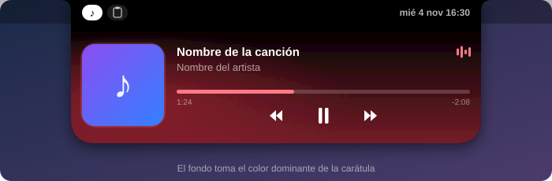
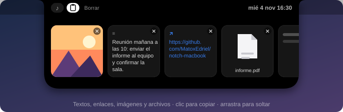
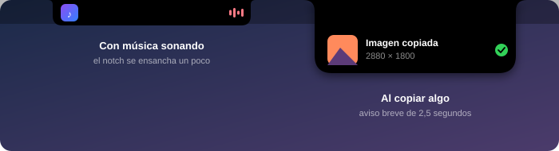

# NotchBar

Convierte el **notch** de tu MacBook en un centro de control: reproductor de música, historial del portapapeles y avisos, todo reactivo al ratón. En Macs sin notch (o en pantallas externas) dibuja un notch virtual.

Pasas el ratón por el notch y se abre con una animación; lo apartas y se cierra.

> Las imágenes de abajo son ilustraciones de cómo se ve cada pantalla, no capturas reales.



## Para qué sirve

### Música
- Muestra lo que suena en **Música** y **Spotify**: carátula, título y artista.
- Controles de anterior, reproducir/pausa y siguiente, y una barra de progreso en la que puedes hacer clic o arrastrar para saltar en la canción.
- El fondo se tiñe con el **color dominante de la carátula**.
- Con el notch cerrado y música sonando, se ensancha un poco y muestra la carátula y unas barras animadas.

### Portapapeles
- Guarda lo que copias: **texto, enlaces, imágenes (incluidas las capturas de pantalla) y archivos**.
- Un clic en una tarjeta lo vuelve a copiar. También puedes arrastrarla a otra app (Mensajes, Slack, Finder…).
- Al copiar algo aparece un aviso breve bajo el notch.





## Requisitos

- macOS 14 (Sonoma) o más reciente.
- Mac con Apple Silicon o Intel (el binario es universal).
- Herramientas de línea de comandos de Xcode (`xcode-select --install`). No hace falta Xcode completo.

## Instalación

```bash
git clone git@github.com:MatoxEdriel/notch-macbook.git
cd notch-macbook
./build.sh install
```

`./build.sh` solo compila y crea `build/NotchBar.app`. Con `install` además copia la app a `/Applications` y la abre.

La app no tiene icono en el Dock: aparece en la barra de menús, donde puedes activar **Abrir al iniciar sesión** o salir.

### Permisos

- **Automatización:** la primera vez que suene algo, macOS preguntará si NotchBar puede controlar Música o Spotify. Si lo rechazas, puedes activarlo en Ajustes del Sistema → Privacidad y seguridad → Automatización.
- La app se firma sin cuenta de desarrollador. Si la pasas a otro Mac, macOS la bloqueará la primera vez: clic derecho → **Abrir**.

## Privacidad

- El historial del portapapeles **solo vive mientras la app está abierta** y cada elemento se borra a las **2 horas**. Se guardan como máximo 15.
- No guarda lo que copian los gestores de contraseñas, que marcan sus copias como privadas.
- Las imágenes se guardan en una carpeta temporal (`~/Library/Caches/NotchBar/Clips`) que se vacía al cerrar y al abrir la app.
- No envía nada a internet. Lo único que descarga es la carátula de Spotify.

## Consumo

Pensada para gastar casi nada en reposo: ~0 % de CPU y alrededor de 30–40 MB de memoria. Con el notch cerrado no sigue el movimiento del ratón, y las barras animadas las ejecuta el sistema.

## Estructura

```
Sources/NotchBar/
├── main.swift               Punto de entrada
├── AppDelegate.swift        Icono de la barra de menús e inicio de sesión
├── NotchController.swift    Ventana del notch y detección del ratón
├── NotchViewModel.swift     Estado y tamaños del notch
├── NotchView.swift          Interfaz (SwiftUI)
├── NotchShape.swift         Forma del notch
├── MusicManager.swift       Música y Spotify, carátula y color
└── ClipboardManager.swift   Historial del portapapeles
```

## Limitaciones

- Solo reconoce **Música de Apple y Spotify**. La música que suena en un navegador no aparece.
- Las barras animadas no siguen el audio real; se mueven mientras algo suena.
